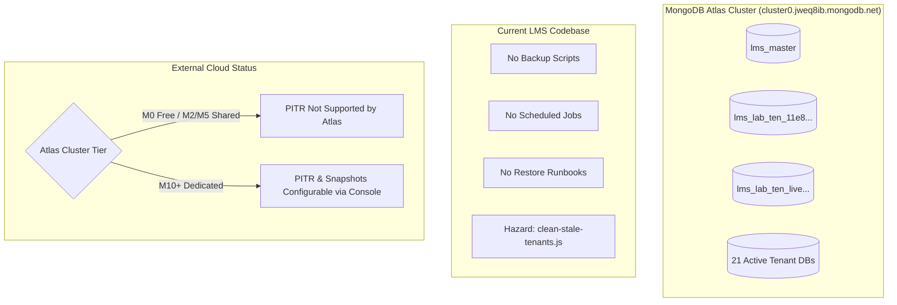
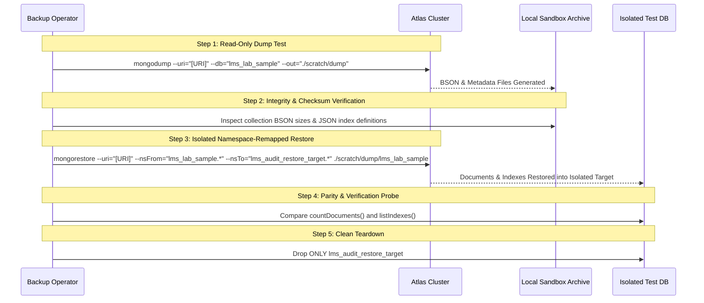

# LMS Phase 10.2: Backup & Restore Readiness Audit Report

**Project:** `D:/Laboratry_medical365/LabManagementSystem`  
**Date of Audit:** October 12, 2026  
**Auditor:** Automated Diagnostic & Database Reliability Assessment  
**Mode:** Read-Only Audit & Threat Modeling (Strictly Non-Destructive; Zero Data or Application Code Modified)  
**Related Reference:** [`docs/PHASE10_SECURITY_AUDIT.md`](file:///d:/Laboratry_medical365/LabManagementSystem/docs/PHASE10_SECURITY_AUDIT.md)

---

## 1. Executive Summary

This audit assesses the database backup, disaster recovery (DR), point-in-time recovery (PITR), and data consistency readiness of the multi-tenant Lab Management System (LMS). The LMS is designed for clinical pathology laboratories, hospital diagnostic networks, and reference centers handling Protected Health Information (PHI) and critical diagnostic reports.

### Readiness Verdict: **CRITICAL GAP — NOT PRODUCTION READY**
The LMS currently possesses **zero automated database backup scripts, zero scheduled snapshot jobs, zero documented disaster recovery runbooks, and no defined Recovery Point (RPO) or Recovery Time (RTO) objectives**. 

Furthermore, the dual-database architecture (`lms_master` vs. `lms_lab_<tenantId>`) introduces substantial **cross-database consistency risks** where independent restores can create split-brain states between the platform registry, released diagnostic report verification tokens, and clinical audit trails.

### Summary of Audit Findings

| Category | Status | Evaluation |
| :--- | :--- | :--- |
| **Atlas Cloud Backups** | ⚠️ **Unverified / High Risk** | Cluster naming indicates a shared/free tier where Atlas Continuous Cloud Backups (PITR) are **not supported**. No automated backups are confirmed. |
| **Backup Scripts & Tooling** | ❌ **Non-Existent (0%)** | Zero `mongodump` or Atlas API scripts in repository. No backup triggers in `package.json` or CI/CD. |
| **Restore Procedures** | ❌ **Non-Existent (0%)** | Zero runbooks or restore documentation exist in `docs/` or operational guides. |
| **Cross-Database Consistency** | ❌ **High Architectural Risk** | Master database holds report verification tokens and central audit logs, while clinical reports reside in tenant DBs. Restores will cause data skew. |
| **RPO & RTO Objectives** | ❌ **Undefined** | No formal Recovery Point Objective or Recovery Time Objective established. |
| **Destructive Script Hazard** | 🚨 **Severe Operational Hazard** | `server/scripts/clean-stale-tenants.js` drops collections across all but 6 tenant databases without backups or dry-run guards. |

---

## 2. MongoDB Atlas Deployment & Backup Capabilities

### 2.1 Confirmed Deployment Configuration

Inspection of the backend environment configuration and active live connection confirmed:

- **Host & Cluster Domain:** Hosted on MongoDB Atlas (`cluster0.jweq8ib.mongodb.net`).
- **Cluster Topology:** Replica Set with Primary (`ReplicaSetWithPrimary`), with primary shards residing on `ac-mesb691-shard-00-*.jweq8ib.mongodb.net`.
- **Master Database Target:** `lms_master` (configured via `MONGODB_MASTER_DB_NAME` in [`server/src/config/env.js`](file:///d:/Laboratry_medical365/LabManagementSystem/server/src/config/env.js#L125)).
- **Transport Security:** Port 27017 with enforced TLS 1.3 encryption and Atlas IP Access List boundary filtering.
- **Connection Multiplexing:** Mongoose connection initialized in [`server/src/config/db.js`](file:///d:/Laboratry_medical365/LabManagementSystem/server/src/config/db.js) with `maxPoolSize: 10` and `serverSelectionTimeoutMS: 15000`.

### 2.2 Backup Capabilities (Confirmed Evidence vs. Assumptions)



#### What is Confirmed:
1. **Zero Repository Backup Tooling:** Searching the entire codebase for `mongodump`, `mongorestore`, `snapshot`, `backup`, and `restore` revealed zero operational scripts or CI/CD pipelines.
2. **Zero In-App Export:** The application has no API endpoints or management services for exporting tenant database archives.

#### What is Unverified (Assumption Caution):
1. **Atlas Cluster Tier:** Cluster naming (`cluster0.jweq8ib.mongodb.net`) typically denotes a shared-tier cluster (M0 Sandbox or M2/M5 Shared). On M0/M2/M5 clusters:
   - **Continuous Cloud Backups (Point-in-Time Recovery / PITR) are NOT available.**
   - **Automated hourly/daily snapshots are NOT available on M0.**
2. **Atlas Console Settings:** Whether a cloud administrator has independently enabled backup schedules or snapshot exports in the MongoDB Atlas Web Console cannot be verified from local code and configuration alone.
3. **Audit Assumption:** Under strict defensive auditing principles, **we must assume NO automated backups exist** until verified in the Atlas Web Console.

---

## 3. Master & Tenant Database Coverage & Layout

### 3.1 Partitioning Strategy
The LMS enforces a database-per-tenant isolation strategy (`TENANT_DB_STRATEGY=isolated_db`):
- Master database name: `lms_master`.
- Tenant database naming: Server-derived `lms_lab_<sanitizedTenantId>` using `TENANT_DB_NAME_PREFIX=lms_lab_`.

### 3.2 Inventory of Active Databases & Collections

A non-destructive read-only audit of the live Atlas cluster revealed **22 LMS databases** (1 Master + 21 Tenant Databases):

#### 1. Master Database (`lms_master` — ~1.30 MB on disk)
| Collection | Document Count | Purpose & Criticality |
| :--- | :---: | :--- |
| `tenants` | **117** | Platform tenant registry, domain mappings, lifecycle state, database provisioning status. **CRITICAL**. |
| `auditlogs` | **1,106** | Centralized immutable audit logs for both platform and tenant actions. **COMPLIANCE CRITICAL**. |
| `reportverifications` | **35** | Public verification tokens for released diagnostic reports. **CLINICAL / LEGAL CRITICAL**. |
| `platformadmins` | **1** | Platform Super Administrator accounts and bcrypt credentials. **SECURITY CRITICAL**. |
| `roles` / `users` | 0 | Master fallback probes (unused; active users reside in tenant DBs). |

#### 2. Tenant Databases (`lms_lab_<tenantId>` — 21 databases present)
Each provisioned tenant database contains dedicated clinical collections:
| Collection | Purpose & Criticality |
| :--- | :--- |
| `users` | Laboratory staff accounts (Director, Pathologist, Technician, Accessioner). |
| `roles` | 6 standard laboratory RBAC roles with fine-grained clinical permissions. |
| `patients` | Protected Health Information (PHI), MRNs, demographics, emergency contacts. |
| `lab_orders` | Diagnostic orders, test requisitions, clinical priority (`STAT` / `ROUTINE`). |
| `samples` | Specimens, barcodes, collection timestamps, container types, storage locations. |
| `testcatalogitems` | Diagnostic test definitions, units, methodologies, reference ranges. |
| `diagnosticreports` | Official clinical test results, pathologist interpretations, digital signatures. |
| `invoices` | Patient invoices, insurance billings, and payment statuses. |
| `recollectiontasks` | Quality assurance recollected sample tracking. |
| `audit_logs` | Tenant collection provisioned during setup (present but clinical writes currently go to `lms_master.auditlogs`). |

### 3.3 Connection Pooling vs. Blueprint Discrepancy
- **Blueprint Statement:** [`docs/database-architecture.md:L127-L128`](file:///d:/Laboratry_medical365/LabManagementSystem/docs/database-architecture.md#L127-L128) states that `mongoose.connection.useDb()` is avoided in favor of dedicated `createConnection()` instances.
- **Actual Active Code:** [`server/src/services/tenantConnection.service.js:L114`](file:///d:/Laboratry_medical365/LabManagementSystem/server/src/services/tenantConnection.service.js#L114) utilizes `mongoose.connection.useDb(dbName, { useCache: true })`.
- **Operational Impact:** Tenant database traffic is multiplexed through the primary master socket pool. A socket outage or TLS handshake drop on the master connection immediately terminates traffic across all 21 tenant databases simultaneously.

---

## 4. Cross-Database Consistency & Recovery Risks

Because the application partitions data across `lms_master` and multiple `lms_lab_*` databases without distributed two-phase transactions, traditional single-database backups create acute consistency hazards:

```
+-----------------------------------------------------------------------------------+
|                           CROSS-DATABASE WRITE SPLIT                             |
+-----------------------------------------------------------------------------------+
|  1. Diagnostic Report Release:                                                    |
|     [Tenant DB: lms_lab_xxx]               [Master DB: lms_master]               |
|     diagnosticreports.status = 'released'  reportverifications.token = 'abc...'   |
|     (Write 1)                             (Write 2)                              |
|                                                                                   |
|  2. Clinical Audit Logging:                                                       |
|     [Tenant DB: lms_lab_xxx]               [Master DB: lms_master]               |
|     lab_orders.create(...)                auditlogs.create(action='ORDER_CREATED')|
|     (Write 1)                             (Write 2)                              |
|                                                                                   |
|  3. Laboratory Onboarding:                                                        |
|     [Master DB: lms_master]               [Tenant DB: lms_lab_xxx]               |
|     tenants.status = 'READY'              db.createCollection('users'...)        |
|     (Write 1)                             (Write 2)                              |
+-----------------------------------------------------------------------------------+
```

### Risk 1: Public Report Verification Split-Brain
- **Mechanism:** When a report is released ([`server/src/services/tenantClinical.service.js:L1660-L1680`](file:///d:/Laboratry_medical365/LabManagementSystem/server/src/services/tenantClinical.service.js#L1660-L1680)), the report is saved in `lms_lab_<tenantId>.diagnosticreports`, and the public authenticity token is upserted into `lms_master.reportverifications`.
- **Restore Hazard:**
  - If a tenant database is restored from a backup taken prior to report release, but `lms_master` is current: A patient scanning a printed QR code reaches [`/api/v1/public/verify-report/:token`](file:///d:/Laboratry_medical365/LabManagementSystem/server/src/routes/public.routes.js), which displays the report as **Authentic and Released**, yet the lab staff inspecting the tenant database cannot find the report or see it in `draft` status.
  - If `lms_master` is restored to an earlier snapshot while tenant databases remain current: Legitimate patient QR codes fail verification, falsely reporting that valid diagnostic results are invalid or unverified.

### Risk 2: Clinical Audit Trail Desync
- **Mechanism:** All tenant clinical operations (order creation, specimen accessioning, result entry, pathologist verification) record audit events to `lms_master.auditlogs` via `auditLogService.recordEvent()`.
- **Restore Hazard:** Restoring a tenant database to recover from data corruption rolls back clinical orders and results, but leaves immutable audit entries in `lms_master` asserting those actions occurred. This creates a severe regulatory discrepancy during HIPAA/CLIA inspection.

### Risk 3: Registry Desync & Orphaned Tenant Databases
- **Empirical Evidence:** The live audit discovered **117 records in `lms_master.tenants`**, but only **21 tenant databases** on disk.
- **Cause:** Historical test suites, offline simulated tenant registrations, or unsynced drop operations leave tenant documents with `database.provisioningStatus = 'READY'` pointing to non-existent databases.
- **Restore Hazard:** If `lms_master` is restored independently of tenant databases, newly provisioned tenant databases become untracked "ghost" databases, while deleted tenants re-emerge as broken 503/404 routes.

### Risk 4: Extreme Hazard in Existing Maintenance Script (`clean-stale-tenants.js`)
- **Location:** [`server/scripts/clean-stale-tenants.js`](file:///d:/Laboratry_medical365/LabManagementSystem/server/scripts/clean-stale-tenants.js)
- **Current Behavior:** Connects directly to the Atlas cluster, lists all databases starting with `lms_lab_ten_`, and **unconditionally drops collections** in all but the 6 most recent databases:
  ```javascript
  const dbsToClean = testDbs.slice(0, Math.max(0, testDbs.length - 6));
  for (const dbInfo of dbsToClean) {
    // drops all collections in tenant database!
  }
  ```
- **Hazard Level:** **CRITICAL OPERATIONAL RISK**. If accidentally executed against staging or production, this script will destroy clinical data across multiple laboratories without prompt, confirmation, or backup.

---

## 5. Environment Variables & Permissions Analysis

A production-grade backup and recovery workflow requires specific credentials, variables, and database privileges configured according to the Principle of Least Privilege:

### 5.1 Required Environment Variables (Safe Specification)

| Variable Name | Purpose | Production Requirement |
| :--- | :--- | :--- |
| `MONGODB_URI` | Live cluster connection string | Standard connection string (credentials withheld). |
| `BACKUP_STORAGE_BUCKET` | Cloud storage target for backup archives | Encrypted AWS S3 bucket, GCP Cloud Storage, or Azure Blob. |
| `BACKUP_ENCRYPTION_PASSPHRASE`| Symmetric encryption key (GPG / AES-256) | Required to secure PHI archives at rest outside of Atlas. |
| `BACKUP_RETENTION_DAYS` | Archive retention schedule | Healthcare standard: Minimum 30 daily, 12 monthly, 7 yearly. |
| `BACKUP_ALERT_WEBHOOK_URL` | Operational alerting webhook | Post failure notifications to Slack/Teams/PagerDuty. |

### 5.2 Required MongoDB User Privileges

The application user currently defined in `server/.env` appears to hold cluster-wide administrative privileges (capable of running `listDatabases` and dropping collections). Automated backup runners should **never** use application read-write accounts:

1. **Backup Service User (`lms_backup_agent`):**
   - Built-in Role: `backup` (on `admin` database) OR `readAnyDatabase`.
   - Cannot write, modify, or drop collections.
2. **Restore Service User (`lms_restore_agent`):**
   - Built-in Role: `restore` (on `admin` database) OR `readWriteAnyDatabase` + `dbAdminAnyDatabase`.
   - Credentials must be stored in secure secret vaults (AWS Secrets Manager, HashiCorp Vault) and only unlocked during verified disaster recovery events.

---

## 6. Recovery Objectives (RPO & RTO) & SLA Requirements

### 6.1 Current Operational Baseline
- **Documented RPO:** **Undefined ($\infty$)**.
- **Documented RTO:** **Undefined**.
- **Disaster Recovery Plan:** None.

### 6.2 Healthcare Regulatory & Clinical Standards

For a clinical laboratory management system managing urgent patient diagnostics (`STAT` orders, critical pathology alerts), standard healthcare IT benchmarks mandate:

```
[Target Timeline]
|<----------- RPO (<= 15 min) ----------->|<---------------- RTO (<= 2 hr) ---------------->|
-----------------------------------------+------------------------------------------------->
Normal Operations                        Disaster Event                                Restored
(Continuous Cloud Backups / Oplog)       (Outage / Ransomware / Corrupt)              (Full Service)
```

| Metric | Target Standard | Rationale |
| :--- | :---: | :--- |
| **RPO (Recovery Point Objective)** | **$\le 15$ minutes** (Target: $\le 1$ min via PITR) | Diagnostic specimen collection and lab order entry cannot tolerate multiple hours of data loss without risking lost patient specimens. |
| **RTO (Recovery Time Objective)** | **$\le 2$ hours** (Target: $\le 30$ min for single tenant) | Inability to report lab results directly impedes emergency and inpatient clinical care. |
| **Backup Frequency** | Continuous Oplog + Daily Snapshot | Enables recovery to any exact second within the last 7 days. |
| **Geo-Redundancy** | Cross-region replication | Secondary cold copy outside primary AWS/GCP region. |

---

## 7. Proposed Safe Non-Production Test Plan

To validate backup and restore capabilities without risking production data or modifying application code, execute the following isolated verification workflow:

### Phase A: Setup & Sandbox Preparation
1. **Target Sandbox Identifier:** Designate an isolated database prefix, e.g. `lms_sandbox_audit_ten01`.
2. **Never Target Production:** Prohibit operations on `lms_master` or any live `lms_lab_ten_*` database.
3. **Dedicated Backup Staging:** Store test archives in a dedicated local scratch path (`scratch/backups/`).

### Phase B: Step-by-Step Validation Procedure



#### Step 1: Isolated Dump Test
Run a read-only dump of an existing test tenant database:
```bash
mongodump --uri="[REDACTED_URI]" --db="lms_lab_ten_live_test_123" --out="./scratch/test_backup" --gzip
```

#### Step 2: Archive & Index Parity Check
Verify that the output directory contains `.bson.gz` and `.metadata.json.gz` files for all expected clinical collections (`users`, `roles`, `patients`, `lab_orders`, `samples`, `diagnosticreports`). Check that unique index definitions (`mrn_1`, `orderNumber_1`, `barcode_1`) are preserved in metadata JSON.

#### Step 3: Namespace-Remapped Restore Test
Execute `mongorestore` with namespace translation to ensure data is written **only** to an isolated non-production target:
```bash
mongorestore --uri="[REDACTED_URI]" \
  --nsFrom="lms_lab_ten_live_test_123.*" \
  --nsTo="lms_restore_test_sandbox.*" \
  --dir="./scratch/test_backup/lms_lab_ten_live_test_123" \
  --gzip
```

#### Step 4: Verification & Consistency Probe
Verify that:
1. `db.users.countDocuments()` matches source.
2. Unique index constraints are functioning in the sandbox database.
3. No writes or index modifications occurred in `lms_master` or `lms_lab_ten_live_test_123`.

#### Step 5: Sandbox Teardown
Drop **only** `lms_restore_test_sandbox` and purge `./scratch/test_backup`.

---

## 8. Items That Could Not Be Verified

The following infrastructure capabilities cannot be confirmed from local repository code and require elevated Atlas Cloud Console access:

| Unverified Item | Reason for Non-Verification | Risk Implication |
| :--- | :--- | :--- |
| **Atlas Cluster Tier (M0 vs M2/M5 vs M10+)** | Connection strings do not specify cluster hardware tier. | If M0/M2/M5, Continuous Cloud Backups (PITR) are **technically impossible** without upgrading to M10+. |
| **Atlas Cloud Snapshot Schedule** | Managed in Atlas Cloud Web Console, not in project Git. | We cannot confirm whether Atlas is taking daily snapshots in the background. |
| **Point-in-Time Recovery (PITR) Status** | Requires MongoDB Atlas Admin API key or console login. | If disabled, data loss in a crash extends back to the last manual dump. |
| **Cross-Region Snapshot Copying** | Cloud provider infrastructure configuration. | Single-region failure would destroy all cluster copies if not replicated. |
| **Atlas Backup Retention Policy** | Managed in Atlas Project Settings. | Snapshot retention window is unknown. |

---

## 9. Actionable Recommendations & Roadmap

### Priority 0: Immediate Defensive Actions (Within 24 Hours)
1. **Decommission or Guard `clean-stale-tenants.js`:**
   - Move `server/scripts/clean-stale-tenants.js` out of the executable path or add an explicit environment guard (`if (process.env.NODE_ENV === 'production') throw new Error(...)`). Add an interactive confirmation prompt and strict `--dry-run` flag.
2. **Verify Atlas Tier via Web Console:**
   - Confirm whether the cluster is M0, M2, M5, or M10+.
   - If currently M0/M2/M5, immediately plan an upgrade to **M10 Dedicated Cluster** prior to commercial go-live.
   - In Atlas Console, enable **Continuous Cloud Backups** (PITR with 7-day retention).

### Priority 1: Automated Tooling & Scripts (Phase 10.3)
1. **Coordinated Backup Script (`backup-cluster.js`):**
   - Create a maintenance script that performs a synchronized dump of `lms_master` and all active tenant databases derived from `lms_master.tenants`.
   - Embed metadata tracking the exact timestamp $T_{backup}$ across all databases.
2. **Per-Tenant Archive & Restore Utility:**
   - Build a CLI utility allowing operators to backup or restore a specific tenant (`lms_lab_<tenantId>`) along with its associated records in `lms_master` (`tenants`, `reportverifications`, `auditlogs`).

### Priority 2: Cross-Database Architecture Hardening (Future Milestone)
1. **Distributed Event Sourcing / Sagas:**
   - When releasing reports or registering audit logs, utilize an outbox pattern or distributed transaction so that failures in one database do not leave orphaned verification records in another.
2. **Formulate Disaster Recovery Runbook (`docs/DISASTER_RECOVERY_RUNBOOK.md`):**
   - Document step-by-step restoration procedures for:
     - Case A: Full cluster catastrophic failure (Restore all databases from PITR).
     - Case B: Single tenant accidental deletion or data corruption.
     - Case C: Point-in-time rollback of master registry.
3. **Formalize SLAs:**
   - Adopt RPO $\le 15$ min and RTO $\le 2$ hours in platform operational service level agreements.
