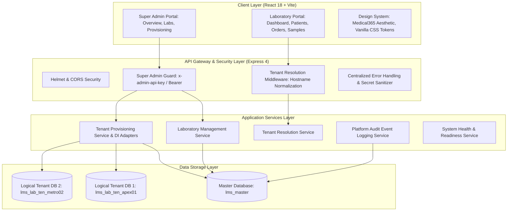

# Lab Management System (LMS) — System Architecture

## 1. System Overview

The **Lab Management System (LMS)** is a standalone, multi-tenant clinical laboratory management and diagnostic platform designed for modern medical laboratories, hospital pathology departments, and commercial testing networks.

Key architectural characteristics:
- **Strict Multi-Tenancy**: Logical database-per-tenant isolation (`lms_lab_<internalTenantId>`). Zero shared patient or order collections.
- **Master Platform Registry**: Centralized directory (`lms_master`) of diagnostic laboratories, verified hostnames, and audit events.
- **Enterprise Security Boundary**: Client-supplied tenant IDs or headers are never trusted as authorization decisions. Super Admin endpoints are strictly guarded by API keys and tokens.
- **Decoupled Architecture**: Independent Express.js REST API backend and React / Vite SPA frontend communicating over standard JSON APIs.

---

## 2. Logical Architecture Layers

---

## 3. Super Admin Capabilities & Endpoints

All platform administration routes are mounted under `/api/v1/super-admin`:

| Method | Endpoint | Description | Security Guard |
| :--- | :--- | :--- | :--- |
| `GET` | `/api/v1/super-admin/overview` | Platform KPI metrics and recent audit log events | `requireSuperAdmin` |
| `GET` | `/api/v1/super-admin/laboratories` | List laboratories with search, pagination, status filters | `requireSuperAdmin` |
| `POST` | `/api/v1/super-admin/laboratories` | Onboard laboratory & trigger dedicated database provisioning | `requireSuperAdmin` |
| `GET` | `/api/v1/super-admin/laboratories/:id` | Retrieve single laboratory profile and database status | `requireSuperAdmin` |
| `PATCH` | `/api/v1/super-admin/laboratories/:id` | Update laboratory profile (name, legalName, email, phone, etc.) | `requireSuperAdmin` |
| `POST` | `/api/v1/super-admin/laboratories/:id/status` | Transition lifecycle state (`PENDING`, `ACTIVE`, `SUSPENDED`, `INACTIVE`) | `requireSuperAdmin` |
| `GET` | `/api/v1/super-admin/laboratories/:id/provisioning` | Safe database provisioning status (zero secrets) | `requireSuperAdmin` |
| `POST` | `/api/v1/super-admin/laboratories/:id/provisioning/retry` | Idempotent database provisioning retry | `requireSuperAdmin` |
| `POST` | `/api/v1/super-admin/laboratories/:id/domains/:domain/verify` | Verify custom domain for hostname tenant resolution | `requireSuperAdmin` |
| `GET` | `/api/v1/super-admin/audit-logs` | Retrieve platform administration audit events | `requireSuperAdmin` |

---

## 4. Tenant Resolution & Hostname Routing

1. Client requests arrive at tenant-facing routes.
2. Ingress host header is sanitized and stripped of ports, paths, or schemes.
3. The host is looked up in the Master Database's `domainMappings`.
4. If the mapping is unverified or unknown, HTTP 404 is returned.
5. If the laboratory is `SUSPENDED` or `INACTIVE`, HTTP 403 is returned.
6. If the laboratory's dedicated logical database is not `READY`, HTTP 503 is returned.
7. If active and ready, `req.tenantContext` is populated with the verified tenant metadata.
8. Anti-Fallback Rule: The server **never** attempts to query another laboratory's database or fall back to master storage.

---

## 5. Technology Stack Summary

- **Frontend**: React 18, Vite 5, JavaScript, React Router 6, Axios, Lucide React, Custom Vanilla CSS Design System.
- **Backend**: Node.js (ES Modules), Express.js 4, Mongoose 8 (MongoDB).
- **Security**: Helmet, strict CORS, API Key guards, normalized hostnames, sanitized error logs with zero credential leakage.
- **Testing**: Node test runner with deterministic memory provisioning adapters for complete offline execution.
