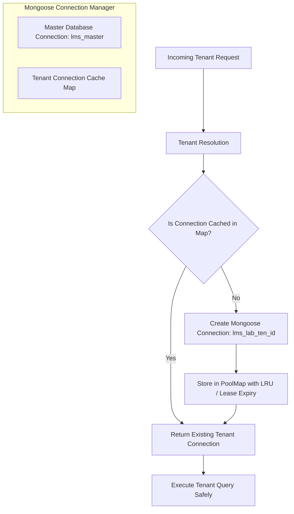

# Database Architecture & Logical Tenant Isolation Blueprint (Phase 2)

## 1. Overview & Strategy

The Lab Management System (LMS) implements a **database-per-tenant logical isolation strategy** (`TENANT_DB_STRATEGY=isolated_db`).

This guarantees:
- **Zero Cross-Tenant Contamination**: Patient records, test results, orders, and diagnostic documents are partitioned into separate MongoDB logical databases.
- **Independent Scalability**: High-throughput reference laboratories can be migrated or balanced across dedicated clusters if needed without modifying the application codebase.
- **Regulatory Compliance**: Satisfies healthcare data sovereignty (HIPAA, CLIA, GDPR) requirements that mandate logical or physical boundary enforcement between medical providers.

---

## 2. Master Database vs. Logical Tenant Database Schemas

### 2.1 Master Database (`lms_master`)

The master database stores only multi-tenant registry records, administrator accounts, and platform audit logs.

#### 1. Laboratory Registry (`Tenant` - `server/src/models/tenant.model.js`)
```javascript
{
  tenantId: { type: String, required: true, unique: true },        // e.g. "ten_5d81b811cfd6"
  code: { type: String, required: true, unique: true },            // e.g. "LAB-APEX-01"
  name: { type: String, required: true },                          // e.g. "Apex Reference Laboratories"
  legalName: { type: String },                                     // Legal entity name
  contactEmail: { type: String, required: true },                  // Director / Admin email
  contactPhone: { type: String },
  status: { 
    type: String, 
    enum: ['PENDING', 'ACTIVE', 'SUSPENDED', 'INACTIVE'], 
    default: 'PENDING' 
  },
  subscriptionPlan: { type: String, default: 'standard' },
  timezone: { type: String, default: 'UTC' },
  locale: { type: String, default: 'en-US' },
  domainMappings: [{
    domain: { type: String, required: true, unique: true },         // Normalized hostname
    isVerified: { type: Boolean, default: false },
    isPrimary: { type: Boolean, default: false },
    verifiedAt: { type: Date }
  }],
  database: {
    databaseName: { type: String, required: true },                // e.g. "lms_lab_ten_5d81b811cfd6"
    provisioningStatus: { 
      type: String, 
      enum: ['NOT_STARTED', 'IN_PROGRESS', 'READY', 'FAILED'], 
      default: 'NOT_STARTED' 
    },
    provisioningStrategy: { type: String, default: 'SERVER_CONTROLLED_LOGICAL_DB' },
    provisionedCollections: [{ type: String }],
    lastProvisionedAt: { type: Date },
    retryCount: { type: Number, default: 0 },
    errorMessage: { type: String, default: null }                  // Sanitized, zero secrets
  },
  address: { street: String, city: String, state: String, postalCode: String, country: String },
  branding: { logoUrl: String, primaryColor: String, secondaryColor: String }
}
```

#### 2. Platform Administrators (`PlatformAdmin` - `server/src/models/platformAdmin.model.js`)
```javascript
{
  adminId: { type: String, required: true, unique: true },
  email: { type: String, required: true, unique: true },
  name: { type: String, required: true },
  role: { type: String, default: 'SUPER_ADMIN' },
  isActive: { type: Boolean, default: true }
}
```

#### 3. Platform Audit Logs (`AuditLog` - `server/src/models/auditLog.model.js`)
```javascript
{
  eventId: { type: String, required: true, unique: true },
  timestamp: { type: Date, default: Date.now },
  action: { type: String, required: true },
  targetTenantId: { type: String, default: null },
  actorType: { type: String, default: 'PLATFORM_SUPER_ADMIN' },
  status: { type: String, enum: ['SUCCESS', 'FAILURE'], default: 'SUCCESS' },
  metadata: { type: mongoose.Schema.Types.Mixed, default: {} }
}
```

---

### 2.2 Logical Tenant Databases (`lms_lab_<internalTenantId>`)

Each tenant database is prepared with the following collections upon provisioning:

| Collection Name | Purpose | Target Phase |
| :--- | :--- | :--- |
| `users` | Laboratory staff accounts, hashed passwords, roles & permissions | Phase 3 |
| `patients` | Protected Health Information (PHI), MRNs, demographics | Phase 3 |
| `orders` | Diagnostic requisitions, ordering physicians, priority (STAT) | Phase 3 |
| `samples` | Specimens, tubes, barcodes, accessioning status, storage | Phase 3 |
| `tests` | Diagnostic analyte catalogs, methodologies, reference ranges | Phase 3 |
| `results` | Analyzer quantitative & qualitative readings, flags | Phase 4 |
| `reports` | Verified clinical reports, pathologist digital sign-offs | Phase 4 |
| `invoices` | Patient bills, copays, insurance claims | Phase 4 |
| `settings` | Facility sequence numbering (ORD-, SMP-), analyzer mappings | Phase 3 |

---

## 3. Database Connection Pooling & Lifecycle Strategy



### 3.1 Connection Isolation Guarantees
- The master database connection (`dbConnection` in `server/src/config/db.js`) is **never** reused as a tenant database connection.
- Calling `mongoose.connection.useDb()` is avoided in favor of dedicated `mongoose.createConnection()` instances to prevent leaking tenant models into global Mongoose state.
- Tenant connection instances are cached by `internalTenantId` to prevent unbounded socket leaks.
- During graceful shutdown (`SIGTERM`, `SIGINT`), all cached tenant connections and the master connection are systematically closed.

---

## 4. Environment Variables Reference

| Variable | Description | Safe Default / Example |
| :--- | :--- | :--- |
| `DB_AUTO_CONNECT` | Connect automatically to MongoDB on boot | `false` (in tests/offline dev) / `true` (live) |
| `MONGODB_URI` | Master MongoDB cluster URI | `mongodb://localhost:27017/lms_master_dev` |
| `TENANT_DB_NAME_PREFIX` | Prefix for server-controlled tenant DB names | `lms_lab_` |
| `TENANT_PROVISIONING_MODE` | Provisioning engine adapter | `mongo` (or `memory` in test suites) |
| `SUPER_ADMIN_API_KEY` | Secret key guarding platform admin operations | `dev-super-admin-key-change-in-production` |
