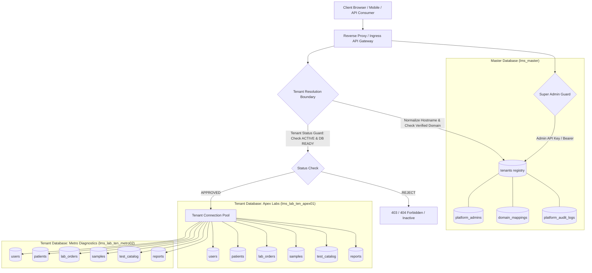

# Multi-Tenant Architecture & Data Isolation Blueprint (Phase 2)

## 1. Executive Architecture Summary

The Lab Management System (LMS) is engineered as an enterprise-grade, multi-tenant healthcare SaaS platform designed for clinical diagnostic laboratories, hospital reference networks, and pathology centers.

The logical architecture enforces strict separation between:
1. **Platform Master Database (`lms_master`)**: Stores the platform registry, administrator accounts, verified domain mappings, subscription tiers, and platform audit logs. Protected Health Information (PHI) is **never** permitted in the Master Database.
2. **Laboratory Tenant Databases (`lms_lab_<internalTenantId>`)**: Each laboratory operates with a completely isolated logical database containing its own staff users, clinical patients, requisitions, biological specimens, test catalogs, results, reports, and invoices.



---

## 2. Platform Master Database Specifications

The platform master database serves exclusively as the administrative orchestrator:

- **Laboratory Registry (`Tenant`)**:
  - `tenantId`: Cryptographically server-generated internal ID (`ten_<random_hex>`, e.g. `ten_5d81b811cfd6`).
  - `code`: Unique laboratory code (uppercase, e.g. `LAB-APEX-01`).
  - `name`: Commercial laboratory name.
  - `legalName`: Legal entity name for compliance and invoicing.
  - `contactEmail` & `contactPhone`: Verified laboratory director/administrator contact.
  - `status`: Lifecycle state (`PENDING`, `ACTIVE`, `SUSPENDED`, `INACTIVE`).
  - `timezone` & `locale`: Reporting regional localization.
  - `domainMappings`: Array of hostnames with verification state (`domain`, `isVerified`, `isPrimary`, `verifiedAt`).
  - `database`: Sub-schema tracking server-controlled database name (`lms_lab_<tenantId>`), provisioning state (`NOT_STARTED`, `IN_PROGRESS`, `READY`, `FAILED`), retry count, and sanitized error messages.
- **Platform Administrators (`PlatformAdmin`)**:
  - Global operators authorized to onboard laboratories and supervise platform operations.
- **Platform Audit Logs (`AuditLog`)**:
  - Immutable record of Super Admin actions, onboarding timestamps, state transitions, and provisioning outcomes.
  - **Zero Secret Leaks**: All tokens, credentials, connection strings, and sensitive patient data are stripped prior to persistence.

---

## 3. Dedicated Tenant Database Provisioning

### 3.1 Server-Controlled Naming Convention
Tenant database names are **strictly derived on the server** using the prefix `lms_lab_` followed by the sanitized internal tenant ID:
$$\text{DatabaseName} = \text{TENANT\_DB\_NAME\_PREFIX} + \text{internalTenantId}$$
Example: `lms_lab_ten_5d81b811cfd6`.

**Security Rules:**
- The browser or API consumer is **never** permitted to supply or suggest a database name.
- Any tenant ID containing directory traversal sequences (`../`), slashes, dots, or MongoDB command operators (`$`) is immediately rejected before database name derivation.

### 3.2 Tenant Provisioning Service & Adapters
The provisioning pipeline is implemented in `server/src/services/tenantProvisioning.service.js` with an extensible Dependency Injection (DI) architecture:
- `MongoTenantProvisioningAdapter`: Connects to MongoDB, derives the tenant database handle, creates initial logical collections (`users`, `patients`, `orders`, `samples`, `tests`, `results`, `invoices`, `settings`), and validates schema readiness.
- `MemoryTenantProvisioningAdapter`: Provides isolated, deterministic in-memory simulation for automated unit testing and offline development without external database daemons.

### 3.3 Provisioning States & Idempotency
- **Lifecycle Flow**:
  1. Onboarding starts: Database marked `NOT_STARTED`.
  2. Provisioning commences: Database marked `IN_PROGRESS`.
  3. On completion: Database marked `READY`, collections recorded, timestamp updated.
  4. On error: Database marked `FAILED`, retry count incremented, sanitized error recorded (no secrets).
- **Idempotency**: Retrying provisioning (`POST /api/v1/super-admin/laboratories/:id/provisioning/retry`) safely evaluates existing collections and re-applies missing structures without corrupting or duplicating existing data.

---

## 4. Laboratory Lifecycle & Activation Guard

### 4.1 Permitted Status Transitions
```
                ┌──────────────┐
                │   PENDING    │
                └──────┬───────┘
                       │ (Activation Guard: requires DB READY)
                       ▼
    ┌─────────────────────────────────────┐
    │               ACTIVE                │
    └───┬─────────────────────────────▲───┘
        │                             │
(Suspend)                             │ (Reactivate)
        ▼                             │
    ┌─────────────────────────────────┴───┐
    │              SUSPENDED              │
    └───┬─────────────────────────────────┘
        │
(Deactivate)
        ▼
    ┌──────────────┐
    │   INACTIVE   │
    └──────────────┘
```

### 4.2 The Activation Guard
A laboratory in `PENDING` status **cannot** be transitioned to `ACTIVE` unless its dedicated tenant database has successfully finished provisioning with status `READY`.
If a Super Admin attempts to activate a laboratory with a `FAILED` or `NOT_STARTED` database, the API rejects the request with HTTP 422:
```json
{
  "success": false,
  "error": {
    "code": "PROVISIONING_NOT_READY",
    "message": "Cannot activate laboratory: Dedicated tenant database has not finished provisioning successfully (Current DB Status: FAILED)."
  }
}
```

---

## 5. Secure Tenant Resolution

### 5.1 Hostname Resolution Rules
When incoming requests arrive at tenant-facing endpoints:
1. The hostname is extracted from the request (via standard Host header or verified proxy headers).
2. The hostname is sanitized and normalized: protocol stripped, port removed, trailing dots removed, lowercased.
3. The normalized hostname is queried against the master registry's `domainMappings`.
4. If found, the domain mapping must have `isVerified === true`.
5. The laboratory must have `status === 'ACTIVE'`.
6. The laboratory's dedicated database must be `READY`.

### 5.2 Header Rejection Guarantee
- Client-supplied headers such as `X-Tenant-ID` or `X-Hospital-ID` are **never** trusted as proof of authorization.
- If supplied, they are recorded as unverified debugging hints only.
- In Phase 3, authenticated requests will derive the tenant ID from the server-validated JWT claim, signed with cryptographic keys unknown to the client.

### 5.3 Anti-Fallback Invariant
If tenant resolution fails, the server returns HTTP 404 `TENANT_NOT_FOUND` or HTTP 403 `TENANT_INACTIVE`. The server **never falls back** to querying another tenant's database or the platform master database.

### 5.4 DNS TXT Record Challenge Workflow
To prevent unauthorized hostname squatting or cross-tenant route hijacking, custom domain mappings require automated DNS ownership verification:
1. **Challenge Token Generation**: When a laboratory registers or adds a custom domain, the server calculates a cryptographic token:
   $$\text{verificationToken} = \text{"lms-verify-"} + \text{SHA256}(\text{tenantId} + ":" + \text{cleanDomain})[0..31]$$
   The domain mapping starts strictly with `isVerified = false`.
2. **DNS Challenge Record**: The laboratory administrator must configure a DNS TXT record at their DNS registrar:
   - **Host / Name**: `_lms-challenge.<domain>`
   - **Type**: `TXT`
   - **Value**: `<verificationToken>` (e.g. `lms-verify-a1b2c3d4e5f6...`)
3. **Automated Verification**: When verification is requested via `POST /api/v1/super-admin/laboratories/:id/domains/:domain/verify`:
   - The server queries DNS for `_lms-challenge.<domain>` TXT records using `dns.promises.resolveTxt`.
   - If the returned TXT records contain the matching token, the domain is marked `isVerified = true`, `verifiedAt = new Date()`, and audit-logged.
   - If no matching TXT record is returned, the verification fails with HTTP 422 `DOMAIN_VERIFICATION_FAILED`, recording the error and keeping `isVerified = false`.
   - Unverified domains are **strictly rejected** by tenant resolution middleware.

---

## 6. Super Admin Security Boundary & Review Corrections

Following the Phase 2 security audit:
1. **Frontend Credential Scrubbing**:
   - Shared administrator API keys (`SUPER_ADMIN_API_KEY`) and Vite environment variables (`VITE_SUPER_ADMIN_API_KEY`) have been completely removed from client-side bundles.
   - The frontend never transmits a shared administrative secret.
   - Unauthenticated client requests to `/api/v1/super-admin/*` receive HTTP 401 Unauthorized, presenting an explicit `AdminSecurityBoundary` lock screen in the UI.
   - Full administrator authentication with server-issued session tokens will be unlocked in Phase 3.
2. **Explicit Provisioning States**:
   - `MemoryTenantProvisioningAdapter` returns `provisioningStrategy: 'OFFLINE_SIMULATED_DB'`, `isLiveDatabase: false`, `provisioningMode: 'OFFLINE_MEMORY'`.
   - `MongoTenantProvisioningAdapter` returns `provisioningStrategy: 'LIVE_MONGODB_LOGICAL_DB'`, `isLiveDatabase: true`, `provisioningMode: 'LIVE_MONGO'`.
   - In production environments, activating a laboratory whose database is an offline simulated database is blocked by the activation guard.
3. **Anti-Fallback Isolation Guarantee**:
   - If a request cannot be resolved to a verified, active tenant, it is rejected immediately. No fallback to another tenant's logical database or the master database is ever performed.
